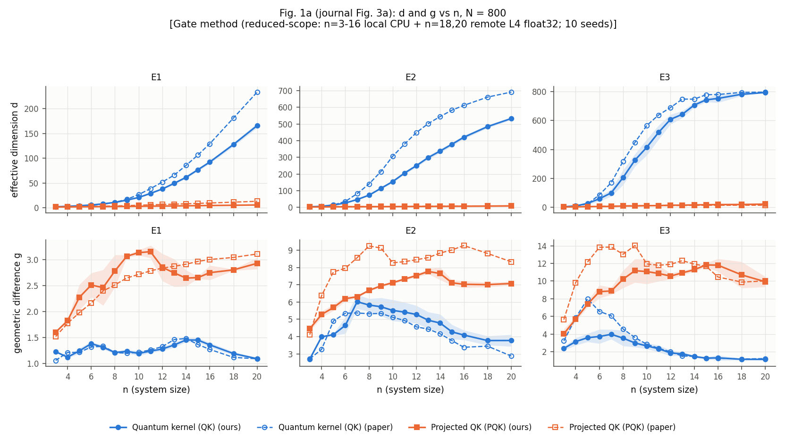
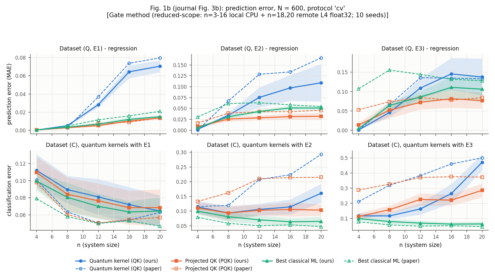
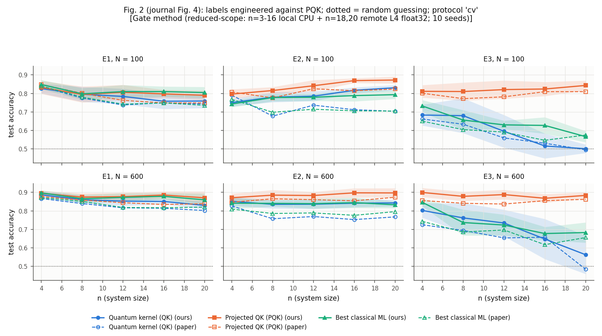
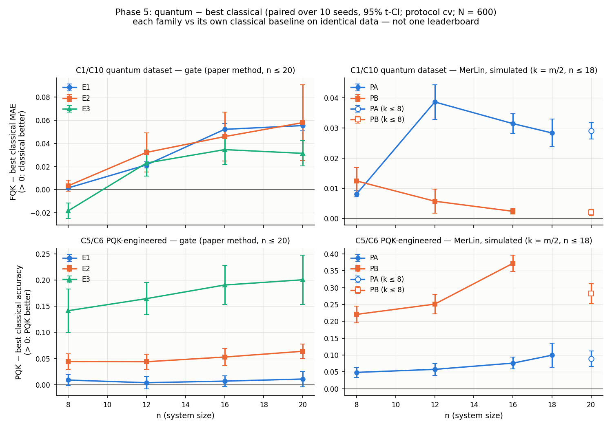
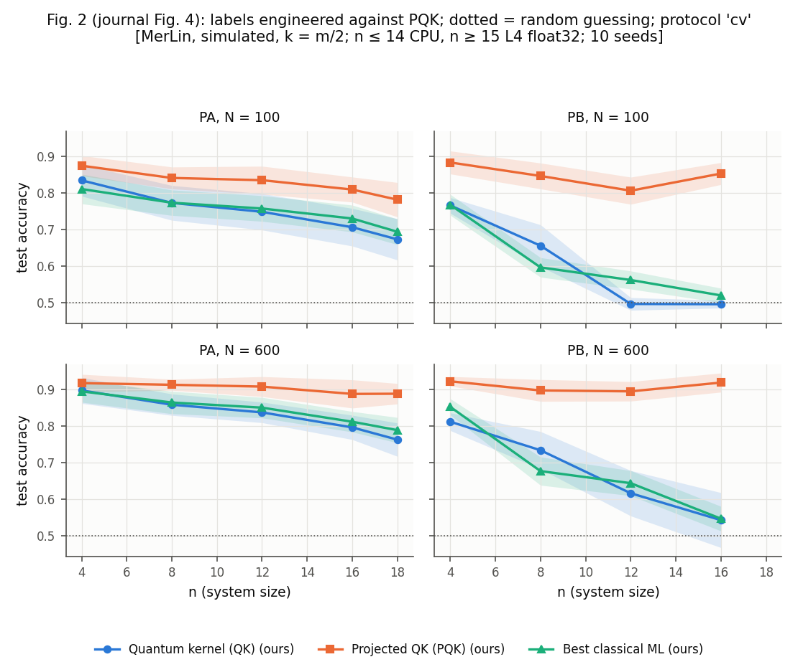
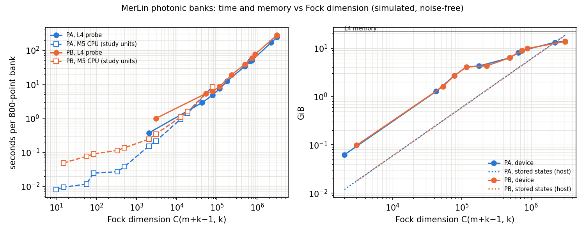

# Power of Data in Quantum Machine Learning - Reproduction

## Reference and Attribution

- Paper: *Power of data in quantum machine learning*, Nature Communications 12,
  2631 (2021).
- Authors: Hsin-Yuan Huang, Michael Broughton, Masoud Mohseni, Ryan Babbush,
  Sergio Boixo, Hartmut Neven, Jarrod R. McClean.
- DOI / arXiv: https://doi.org/10.1038/s41467-021-22539-9 /
  https://arxiv.org/abs/2011.01938
- Original repository: none released. The journal's code statement points to
  a TensorFlow-Quantum tutorial for "smaller numerical experiments"
  (https://www.tensorflow.org/quantum/tutorials/quantum_data). This
  reproduction does not reuse its code; it is used only as a reference for
  circuit conventions.
- Paper values: the journal's Source Data workbook (exact plotted values;
  cached under `data/power_of_data_qml/sources/`, see `VISITED_URLS.md`).
- Dataset: Fashion-MNIST, MIT License, Copyright (c) 2017 Zalando SE (Xiao,
  Rasul and Vollgraf, arXiv:1708.07747).

## Original Paper

The paper asks when a quantum model can predict better than classical machine
learning once training data are available.

- **Theory.** For kernel models it proves a data-dependent bound,
  `E|h(x) - f(x)| <= c sqrt(s_K / N)`, where `s_K` is the model complexity.
  It also defines a label-free *geometric difference*
  `g(K^C || K^Q) = sqrt(|| sqrt(K^Q) (K^C)^-1 sqrt(K^Q) ||)`, which caps how
  much worse a classical kernel can be than a quantum one: `s_C <= g^2 s_Q`.
- **Claim: data elevates classical models.** Even labels generated by
  classically hard quantum circuits can be learned well by tuned classical
  models.
- **Claim: the fidelity kernel fails at scale.** The fidelity quantum kernel
  `Tr[rho(x) rho(x')]` degrades with qubit count, because its effective
  dimension `d` approaches the number of data points N and `g` collapses.
- **Proposal: projected quantum kernels (PQK).** These are Gaussian kernels on
  single-qubit reduced density matrices. On Fashion-MNIST-derived datasets
  whose labels are *engineered* to saturate `s_C = g^2 s_PQ`, PQK beats the
  best of six tuned classical models by more than 20% accuracy, up to 30
  simulated qubits.

Datasets: Fashion-MNIST, reduced by PCA to `n` features, with an 800-point
subsample.
- Dataset (C): dress vs. shirt.
- Datasets (Q, E1/E2/E3): QNN expectation values under three embeddings
  (separable rotations, IQP, Heisenberg evolution).
- Engineered datasets: labels built to saturate the geometric inequality.

Metrics: test MAE (regression on Q datasets), test accuracy or error
(classification on C and engineered datasets), effective dimension `d`,
geometric difference `g`.

## Reproduction Scope, Claims, and Deviations

Status: **complete at a reduced scope.** The gate-model study covers n = 3–16
locally and n = 18, 20 on a remote NVIDIA L4, with 10 seeds, the paper's
hyperparameter grids and two selection protocols. Fig. S2 (training size) and
Fig. S3 (bound) are at the paper's scale. A MerLin photonic adaptation
(`MERLIN_IMPLEMENTATION`) was added and pushed to the memory limit of one
NVIDIA L4 (18 modes with k = m/2 photons; n = 20 with photons capped at 8), with
a backend-scaling report. A fair-comparison analysis covers both families. The
paper's n = 21–30 range was not run. The claim inventory, ambiguity log and all
run records are in `LOG.md`.

| Claim | Statement | Status |
|---|---|---|
| C1 | With data, tuned classical ML matches or beats quantum kernels on quantum-generated labels | reproduced (trend) |
| C2 | Small `g` implies no quantum advantage | reproduced |
| C3 | The fidelity QK's `d` tends to N and `g` collapses | reproduced (trend; `d` grows more slowly for E1/E2) |
| C4 | The PQK keeps a low `d` and a larger `g` | reproduced |
| C5/C6 | Engineered-label PQK advantage follows `g` and holds against all six classical families | reproduced for E3, partly for E2, none for E1 (as in the paper) |
| C7 | QK-engineered labels show no QK advantage at large n | partly reproduced (n ≤ 20) |
| C8 | The gap shrinks with training size | reproduced (trend) |
| C9 | The regularized bound tracks the error | reproduced |
| C10 | PQK helps on (Q, E3); classical is best on (C) | reproduced in direction; magnitudes differ |
| T1, T2 | Bound and `g` inequalities | verified numerically in tests |
| T3–T5 | Complexity-theoretic statements | not reproduced (pure theory) |

| Experiment | Paper figure (arXiv / journal) | Config |
|---|---|---|
| `d` and `g` vs n | Fig. 1a / Fig. 3a | `study_*` (component `dimension_geometry`) |
| Prediction error on (Q, E1–E3) and (C) | Fig. 1b / Fig. 3b | `study_*` (`quantum_dataset`, `classical_dataset`) |
| PQK-engineered datasets | Fig. 2 / Fig. 4 | `study_*` (`engineered_pqk`) |
| QK-engineered datasets | Fig. S1 / Supp. Fig. 2 | `study_*` (`engineered_qk`) |
| Bound vs. error | Fig. S3 / Supp. Fig. 4 | `study_*` (`bound`) |
| Error vs. training size | Fig. S2 / Supp. Fig. 3 | `training_size_original.json` |
| Convention checks against the Source Data | — | `convention_check_geometry*.json`, `convention_check_reduced.json` |

Updates and deviations (details and rationale in `LOG.md`):

- **Simulator.** TensorFlow-Quantum cannot be installed on this platform. The
  embeddings and the QNN are simulated exactly with a batched PyTorch
  statevector simulator (CPU or CUDA). Unit tests check every gate and
  embedding against dense `scipy.linalg.expm` references.
- **Inferred conventions.** The paper text is ambiguous on several points, and
  each one is a config value (`conventions`, `kernels`, `engineered`):
  - the E2 formula lacks the imaginary unit;
  - the E3 register size and time scale;
  - the QNN boundary;
  - the PQK bandwidth for `d`, `g` and label construction;
  - the label threshold;
  - the **effective input scale** (AMB-17). At `input_scale = 1`, our effective
    dimensions at small `n` are far larger than the Source Data values, even
    for the parameter-free E1 kernel.
  The `convention_check` sweeps score these choices against the Source Data
  (see "Sweeps and selections" below). The fitted values are label-free
  geometry quantities matched to the published ones, so the geometry agreement
  below is partly by construction.
- **Hyperparameter selection.** The paper reports the best *test* score over
  each grid. That is reproduced as protocol `paper`, labelled optimistic. A
  5-fold cross-validated protocol `cv` is added for fair verdicts.
- **Extension baseline.** A polynomial-kernel SVM/KRR is added to the
  classical suite and to the `g` minimization. It is reported separately as
  `*_with_extension`.
- **Inadmissible `g_tra`.** When no (classical kernel, λ) pair meets the
  paper's `g_tra < 0.045` rule, the pair with the smallest `g_tra` is reported
  with `threshold_met: false`. This never happened in the final aggregates
  (`g_threshold_not_met=0`).
- **Engineered-label threshold.** Labels are split at the median. The paper's
  sign threshold gives single-class labels for every embedding (the kernels
  are entrywise positive), so it cannot produce the paper's 0.5 chance level.
- **Scale and precision.** The paper simulates up to 30 qubits. This
  reproduction covers n = 3–16 on the laptop (float64) and n = 18, 20 on an
  NVIDIA L4 (float32/complex64). n = 17, 19 and n ≥ 21 were not run.
  CV was run at n = 4, 8, 12, 16 locally and n = 20 remotely. `study_original.json`
  keeps the paper scale as a reference config.

## Project Layout

```text
cli.json               paper-specific CLI schema
configs/               defaults and named experiments (see Configuration)
lib/
  data.py              Fashion-MNIST IDX loading, PCA, standardization, subsamples
  simulator.py         batched statevector gates (Heisenberg bond, Hadamard, phases)
  embeddings.py        E1/E2/E3, labelling QNN, per-subsample quantum banks
  kernels.py           classical, fidelity and projected kernels
  geometry.py          effective dimension, g_gen/g_tra, s_K, bound, engineered labels
  models.py            paper grids, candidates, `paper` and `cv` selection protocols
  study.py             (seed, n, embedding) units; training-size study
  convention_check.py  EXP-AMB variant scoring against the Source Data
  photonic_merlin.py   MerLin photonic adaptation (PA, PB embeddings; FQK, no-click PQK, labels;
                       CPU/GPU, photon cap, blocked fidelity Gram)
  photonic_scaling.py  experiment `photonic_scaling`: bank time and memory vs Fock dimension
  paper_values.py      Source Data loader
  summary.py           per-seed rows, aggregation, paired differences
  runner.py            train_and_evaluate entry point and evidence files
  experiment_logging.py
utils/                 aggregate_study, plot_figures, plot_training_size, report_claims,
                       report_convention_check, compare_systems, plot_comparison,
                       evaluate_photonic, report_photonic_scaling, export_per_seed,
                       diagnose_input_scale
tests/                 simulator, geometry (theory checks), models, CLI, smoke, photonic
results/               curated tables, aggregates and figures (see Results)
outdir/                raw run directories (disposable)
models/                unused: kernel methods have no trained artifacts to keep
```

## Install and How to Run

```bash
pip install -r papers/power_of_data_qml/requirements.txt
```

Smoke run (about 2 min on a laptop; `defaults.json`: n = 3–4, 2 seeds, tiny
grids; not for reported results):

```bash
# From the repository root
python implementation.py --paper power_of_data_qml
# From inside papers/power_of_data_qml
python ../../implementation.py
```

Experiments (full reproduction; on an Apple M5 the gate study takes about 7.9 h,
the photonic study 2.9 h and the training-size study 1.1 h):

```bash
python implementation.py --paper power_of_data_qml --config configs/convention_check_geometry.json
python implementation.py --paper power_of_data_qml --config configs/convention_check_geometry_refine.json
python implementation.py --paper power_of_data_qml --config configs/study_reduced_local.json --seeds 0,1,2,3,4
python implementation.py --paper power_of_data_qml --config configs/study_reduced_local.json --seeds 5,6,7,8,9
python implementation.py --paper power_of_data_qml --config configs/training_size_original.json
python implementation.py --paper power_of_data_qml --config configs/study_photonic_reduced_local.json --seeds 0,1,2,3,4
python implementation.py --paper power_of_data_qml --config configs/study_photonic_reduced_local.json --seeds 5,6,7,8,9
# NVIDIA GPU (float32), n = 18 and 20, one batch of 5 seeds takes about 3.7 h on an L4:
python implementation.py --paper power_of_data_qml --config configs/study_reduced_remote.json \
  --system-sizes 18,20 --cv-system-sizes 20 --seeds 0,1,2,3,4 --device cuda:0
python implementation.py --paper power_of_data_qml --config configs/study_reduced_remote.json \
  --system-sizes 18,20 --cv-system-sizes 20 --seeds 5,6,7,8,9 --device cuda:0
# MerLin photonic adaptation on the GPU (L4: about 2.3 h per 5 seeds for 3a, 1.8 h for 3b, 4 h per 5 seeds for the capped run):
python implementation.py --paper power_of_data_qml --config configs/photonic_scaling_probe_remote.json --device cuda:0
python implementation.py --paper power_of_data_qml --config configs/study_photonic_remote.json --seeds 0,1,2,3,4 --device cuda:0
python implementation.py --paper power_of_data_qml --config configs/study_photonic_remote.json --seeds 5,6,7,8,9 --device cuda:0
python implementation.py --paper power_of_data_qml --config configs/study_photonic_remote_pa18.json --device cuda:0
python implementation.py --paper power_of_data_qml --config configs/study_photonic_capped_remote.json --seeds 0,1,2,3,4 --device cuda:0
python implementation.py --paper power_of_data_qml --config configs/study_photonic_capped_remote.json --seeds 5,6,7,8,9 --device cuda:0
```

Notebook: `notebook.ipynb` is the guided walkthrough (claim, method, live smoke
experiment, stored headline results, fair baseline, controls, photonic
adaptation, conclusions). It runs top to bottom on a laptop CPU in about 4 minutes
with the repository `.venv` as the kernel. Its per-seed evidence comes from
`results/per_seed_key_rows.csv` (`utils/export_per_seed.py`).

Aggregation and figures (commands recorded in `LOG.md`):

```bash
python utils/aggregate_study.py --run outdir/run_A --run outdir/run_B \
  --expected-seeds 0-9 --expected-sizes 3-16,18,20 --output results/study_extended
python utils/plot_figures.py --aggregate results/study_extended.json --label "<scope label>" \
  --protocol cv --results-dir results/figures_extended
python utils/report_claims.py --aggregate results/study_extended.json --sizes 8,12,16,18,20 \
  --output results/claim_table_extended
python utils/compare_systems.py --gate results/study_extended.json \
  --photonic results/study_photonic_reduced_local.json --training-size results/training_size.json \
  --output results/comparison_extended
```

Useful flags (authoritative list in `cli.json`): `--experiment`,
`--system-sizes 3,4,5`, `--seeds 0,1`, `--cv-system-sizes`,
`--quantum-kernel-max-qubits`, `--grid paper|smoke`, `--n-jobs`,
`--batch-memory-mb`, `--photonic-max-photons`. Global flags include `--config`, `--outdir`, `--device`,
`--dtype` (`float64` selects complex128 simulation, `float32` complex64),
`--data-root` and `--log-level`.

## Configuration

| Config | Purpose |
|---|---|
| `defaults.json` | Smoke defaults. Every block is explicit (`study`, `conventions`, `kernels`, `engineered`, `models`, `photonic`, `photonic_scaling`, `simulation`, `training_size`, `convention_check`) |
| `study_reduced_local.json` | n = 3–16, 10 seeds, paper grids, `paper` and `cv` protocols (CV at n = 4, 8, 12, 16) |
| `study_reduced_remote.json` | CUDA, float32, 10 seeds, paper grids. Declares n = 17–20; the reported runs override it with `--system-sizes 18,20` |
| `study_original.json` | Paper scale, n = 3–30 (reference; not run) |
| `training_size_original.json` | Fig. S2: (Q, E2), n = 10–13, N ∈ {100, …, 1600} |
| `convention_check_geometry.json` | EXP-AMB stage A: 24 convention variants, n = 3–8 |
| `convention_check_geometry_refine.json` | EXP-AMB stage A2: 28 variants (scale, E3 structure, PQK γ) |
| `convention_check_reduced.json` | Small convention check at n = 3–6 |
| `diagnostic_gaps_n12.json` | Exploratory gap diagnostics at n = 12 |
| `study_photonic_smoke.json` | MerLin adaptation smoke run (n = 4–5, 1 seed, tiny grids) |
| `study_photonic_reduced_local.json` | MerLin adaptation: PA/PB, n = 4–14, 10 seeds, paper grids, `paper` + `cv` |
| `photonic_scaling_probe_remote.json` | Experiment `photonic_scaling`: time and memory of 20 photonic banks vs Fock dimension, L4 float32, plus a CPU cross-check |
| `study_photonic_remote.json` | MerLin adaptation on the L4: PA/PB, n = 15–17, k = m/2, 10 seeds, CV at n = 16 |
| `study_photonic_remote_pa18.json` | MerLin adaptation on the L4: PA, n = 18 (9 photons in 18 modes), CV |
| `study_photonic_capped_remote.json` | MerLin adaptation on the L4, photons capped at k ≤ 8 (`photonic.max_photons`): PA/PB, n = 17–20, CV at n = 20 |

The classical baselines run inside the same study run as the quantum models,
on identical subsamples and splits, so every comparison is paired.

## Data

Fashion-MNIST, the original dataset used by the paper:

- Source: the official release by Zalando Research
  (https://github.com/zalandoresearch/fashion-mnist), MIT License.
- Path: `data/power_of_data_qml/fashion_mnist/`, under the repository data root
  (`DATA_DIR` or `--data-root` override it). It holds the four official
  gzipped IDX files plus `MD5SUMS` and `SHA256SUMS`. The real dataset was used
  in every reported run; no synthetic fallback was needed.
- Contents: all 70,000 images (60k train + 10k test), 10 balanced classes. PCA
  is fit on all 70k images; the paper's standardization and 800-point
  subsampling are applied in code.
- Acquisition (from the repository root):

  ```bash
  mkdir -p data/power_of_data_qml/fashion_mnist && cd data/power_of_data_qml/fashion_mnist
  for f in train-images-idx3-ubyte.gz train-labels-idx1-ubyte.gz \
           t10k-images-idx3-ubyte.gz t10k-labels-idx1-ubyte.gz; do
    curl -fL -o "$f" "http://fashion-mnist.s3-website.eu-central-1.amazonaws.com/$f"
  done
  md5sum -c MD5SUMS   # macOS: md5 -r *.gz and compare with MD5SUMS
  ```

- Paper reference values: the Source Data workbook under
  `data/power_of_data_qml/sources/` (see `VISITED_URLS.md`).
- Limitations: the paper releases no preprocessed features or labels. The QNN
  labels and the engineered labels are regenerated from the paper's procedure,
  so they follow the paper's distribution, not its exact samples.

Each run writes `outdir/run_YYYYMMDD-HHMMSS/` containing:
- `config_snapshot.json`
- `run.log`
- `run_status.json`
- `metrics.json`: summary rows with mean, std, 95% CI and the matching paper
  value;
- `records*.jsonl`: every per-seed record.

Curated artifacts live in `results/`: aggregates (`study_*.json`, `*_summary.csv`),
claim tables (`claim_table*.md`), `comparison*.md`, `convention_check_candidates.md`
and figures. Remote evidence copies are under `outdir/remote/`.

## Results Obtained and Comparison with the Paper

Scope labels:
- `partial`: n = 3–16 (local, CPU float64) plus n = 18, 20 (remote L4, float32)
  against the paper's 3–30, 10 seeds, paper grids. 640/640 expected records
  (`results/study_extended.json`).
- `paper-scale`: Fig. S2 (n = 10–13, 10 seeds) and Fig. S3 (n = 3–12).
- The earlier n ≤ 16 artifacts (`results/study_reduced_local.json`,
  `claim_table.md`, `comparison.md`, `figures/`) are kept unchanged. The
  extended versions are `*_extended*` and `figures_extended/`.

Figures in `results/figures_extended/` compare our results (solid lines, ±1 std
bands) with the journal Source Data (dashed lines). `results/claim_table_extended.md`
has every number (mean ± std, paired differences with 95% CIs, both selection
protocols).





**Conventions fitted to the Source Data** (EXP-AMB). These were chosen before
the main study, by predeclared rules:
- input scale 0.3 on the standardized features;
- E2 ZZ coefficient 2;
- E3 on n+1 qubits, with time (n+1)/3;
- PQK bandwidth γ = 0.1/(n·Var);
- engineered labels split at the median.

The paper's text implies scale 1. At scale 1 the effective dimensions come out
about 10× larger than the published ones, even for the parameter-free E1
kernel.

### Paper vs. reproduction

Delta = reproduced − paper. Reproduced values are means over 10 seeds; the
selection protocol is `cv` unless noted, N = 600. Paper values are the journal
Source Data. Metric agreement: *close* is within 10% of the paper value,
*moderate* within 30%, *off* beyond that. Entries with three values are
E1 / E2 / E3. "QK−best" and "PQK−best" are the paired quantum minus best
classical differences. For differences below 0.02 the relative rule overstates
disagreement, so read those rows through the Delta column. Test-set (`paper`
protocol) numbers are in `results/claim_table_extended.md`.

| Paper item | Claim tested | Paper value | Reproduced value | Delta | Metric agreement | Trend agreement | Claim support | Seeds | Comment |
|---|---|---:|---:|---:|---|---|---|---:|---|
| Fig. 1a, `d_QK`, n=16 | C3 | 129.2 / 612.1 / 780.9 | 92.2 / 420.6 / 753.6 | −37.0 / −191.5 / −27.3 | moderate / off / close | yes (grows with n) | supported (trend) | 10 | E1/E2 grow more slowly: consistent with a rising effective input scale (see Gaps) |
| Fig. 1a, `d_QK`, n=20 | C3 | 233.6 / 691.9 / 797.5 | 165.9 / 533.1 / 794.7 | −67.7 / −158.8 / −2.8 | moderate / moderate / close | yes | supported (trend) | 10 | E3 saturates at N = 800 as in the paper (float32 remote) |
| Fig. 1a, `d_PQK`, n=16 | C4 | 9.5 / 7.1 / 13.2 | 4.4 / 6.3 / 18.3 | −5.1 / −0.8 / +5.1 | off / moderate / off | yes (stays low) | supported | 10 | `d_PQK` ≤ 22 at every point (n ≤ 20) |
| Fig. 1a, `g_QK`, n=16 | C3 | 1.27 / 3.38 / 1.27 | 1.36 / 4.09 / 1.31 | +0.09 / +0.71 / +0.04 | close / moderate / close | yes (E3 collapses toward 1) | supported | 10 | label-free; partly fitted (AMB-17) |
| Fig. 1a, `g_PQK`, n=16 | C4 | 3.00 / 9.28 / 10.46 | 2.75 / 7.03 / 11.80 | −0.25 / −2.25 / +1.34 | close / moderate / moderate | yes (`g_PQK` > `g_QK`) | supported | 10 | ordering E1 < E2 < E3 preserved |
| Fig. 1a, `g_PQK`, n=20 | C4 | 3.10 / 8.34 / 10.01 | 2.92 / 7.08 / 9.92 | −0.18 / −1.26 / −0.09 | close / moderate / close | yes | supported | 10 | |
| Fig. 1b, QK−best MAE, n=16 | C1 | +0.058 / +0.076 / +0.002 | +0.052 / +0.046 / +0.035 | −0.006 / −0.030 / +0.033 | moderate / off / off | yes (classical better, all CIs exclude 0) | supported | 10 | the paper's E3 gap is about 0; ours is larger (stronger classical baseline, G1) |
| Fig. 1b, PQK−best MAE, n=16 | C1, C10 | −0.007 / −0.016 / −0.054 | −0.002 / −0.020 / −0.029 | +0.005 / −0.004 / +0.025 | off / moderate / off | yes (PQK better for all three; every 95% CI excludes 0) | supported (direction) | 10 | the E1 difference is tiny (−0.002), which inflates its relative error; the E3 advantage is about half the paper's |
| Fig. 1b, Dataset (C) error, n=16 | C10 | best classical 0.053 | 0.064 | +0.011 | moderate | yes (classical best or tied) | supported (direction) | 10 | E3 kernels err 0.22–0.27 vs the paper's 0.38–0.46 (G2, unresolved) |
| Fig. 2, PQK−best accuracy, n=16, N=600 | C5, C6 | +0.018 / +0.079 / +0.238 | +0.007 / +0.053 / +0.190 | −0.011 / −0.026 / −0.048 | off / off / moderate | yes (grows E1 < E2 < E3) | supported (E3, E2); E1 tie | 10 | the gap exceeds 0.19 for E3, below the paper's 0.24 |
| Fig. 2, PQK−best accuracy, n=20, N=600 | C5, C6 | +0.018 / +0.078 / +0.207 | +0.011 / +0.064 / +0.201 | −0.007 / −0.014 / −0.006 | off / moderate / close | yes | supported (E3, E2); E1 tie | 10 | remote float32 run; CV at n=20 only |
| Fig. S1, QK−best accuracy, QK-engineered, n=16, N=600 | C7 | −0.003 / +0.058 / +0.037 | −0.005 / +0.038 / +0.021 | −0.002 / −0.020 / −0.016 | off / off / off | partly (see comment) | partially supported | 10 | E1 tie, E3 tie, E2 QK better; "large n" not reached |
| Fig. S1, QK−best accuracy, QK-engineered, n=20, N=600 | C7 | −0.004 / +0.046 / −0.102 | −0.012 / +0.040 / −0.068 | −0.008 / −0.006 / +0.034 | off / moderate / off | yes for E3 (QK loses), E2 QK better persists | partially supported | 10 | E3's QK advantage vanishes; E2's persists up to n=20 |
| Fig. S2, PQK−best MAE vs N, (Q, E2), n=10 | C8 | −0.038 (N=100) → −0.012 (N=1600) | −0.018 → −0.008 | +0.020 → +0.004 | off | yes (gap shrinks as N grows) | supported (trend) | 10 (paper n=13: 8) | MAE is about 30–40% below the paper's |
| Fig. S3, bound vs error, (Q), n=3–12 | C9 | N/A (qualitative trend; no scalar reported) | Spearman 0.987; bound ≥ error at 30/30 | N/A | N/A | yes | supported | 10 | |
| Theory: `s_K = ‖w‖²`, `s_C ≤ g² s_Q`, saturation | T1, T2 | exact | holds to numerical precision | N/A | close | yes | verified | n/a | `tests/test_geometry.py` |

The remaining Fig. 1b/2/S1 values at n = 8, 12, 18 and both protocols are in
`results/claim_table_extended.md`.

### Extension to n = 18, 20 (remote NVIDIA L4)

Both remote batches covered seeds 0–9 at n = 18 and 20. They used float32
simulation on `gpu-reproduced-papers-1`, and every component ran. CV was run at
n = 20 only, so n = 18 has the `paper` protocol only. Together with the local
runs this gives 640/640 records (`results/study_extended.json`). Tables:
`results/claim_table_extended.md` and `results/comparison_extended.md`.
Figures: `results/figures_extended/`. Values for n ≤ 16 come from local CPU
float64 runs. A bridge run of `defaults.json` on both machines agrees on the
geometry to 1e-11 and on the task metrics to 0.007 (tree models only, from a
scikit-learn version difference). Float32 vs float64 changes `d` by about 1e-3
relative and the labels by about 6e-6.

| Claim (N=600, cv) at n=20 | E1 | E2 | E3 |
|---|---|---|---|
| d_QK (paper) | 165.9 (233.6) | 533.1 (691.9) | 794.7 (797.5) |
| C1 QK − best classical MAE | +0.055, classical better | +0.058, classical better | +0.031, classical better |
| C1 PQK − best classical MAE | −0.001, PQK better | −0.019, PQK better | −0.029, PQK better |
| C5/C6 PQK − best (accuracy) | +0.011, tie | +0.064, PQK better | +0.200, PQK better |
| C7 QK − best (accuracy) | −0.012, tie | +0.040, QK better | −0.068, classical better |

The C1, C5 and C6 directions at n=16 also hold at n=20. C7 now looks
different: the E3 fidelity kernel was a tie at n=16 and loses at n=20. Its
d_QK ≈ 795/800 shows the kernel is nearly the identity. This is the kernel
concentration the paper uses to motivate the PQK.

### Claim verdicts

| Claim | Verdict | Key numbers (ours vs paper) |
|---|---|---|
| Classical ML with data is competitive with quantum kernels on quantum-generated labels (C1) | supported, trend reproduced | QK − best classical MAE (CV): E1 +0.052, E2 +0.046, E3 +0.035 at n=16; +0.055 / +0.058 / +0.031 at n=20 (QK worse; all 95% CIs exclude 0) |
| QK effective dimension → N and `g` collapses; PQK keeps low `d` and higher `g` (C3, C4) | supported, trend reproduced | d_QK(E3) 754 vs 781 (n=16), 795 vs 798 (n=20); g_PQK(E3) 11.8 vs 10.5. E1/E2 `d` grows more slowly than the paper's (see Gaps) |
| PQK beats the best of six tuned classical models on engineered data, gap follows `g` (C5, C6) | supported for E3, partial for E2, none for E1 (as in the paper) | PQK − best accuracy (CV, N = 600): E3 +0.190 at n=16 and +0.201 at n=20 (paper +0.238, +0.207); E2 +0.053 and +0.064 (paper +0.079, +0.078); E1 +0.007 and +0.011 (n.s.) |
| QK-engineered labels: no QK advantage at large n (C7) | partially supported | E3 QK advantage vanishes (tie at n=16, classical better at n=20); E2 QK advantage persists to n=20; n ≈ 28 untested |
| The gap shrinks as the training size grows (C8) | supported, trend reproduced | n = 10: PQK − best MAE −0.018 at N = 100 → −0.008 at N = 1600 (paper −0.038 → −0.012) |
| The classical error bound tracks the actual error (C9) | supported | Spearman ρ = 0.987 over 30 points; bound ≥ error at 30/30 |

### Sweeps and selections

All sweeps below ran to completion; none is partial.

| Sweep | Declared metric (direction) | Split and aggregation | Runs | Completeness | Selected |
|---|---|---|---|---|---|
| EXP-AMB stage A (`convention_check_geometry.json`, attempt 2 `run_20261017-033107`; attempt 1 is superseded for a logging defect) | mean relative error to the Source Data of `d`, `g` (lower is better) | n = 3–8, seeds 0–2; seed means, then mean over n; tie tolerance 0.02 | 1/1 run, 24/24 variants, 1,296/1,296 units | COMPLETE | input scale 0.3; E2 pair coefficient 2 |
| EXP-AMB stage A2 (`convention_check_geometry_refine.json`, `run_20261016-163902`) | same, with the selection sums defined in `utils/report_convention_check.py` | same | 1/1 run, 28/28 variants, 1,512/1,512 units | COMPLETE | E3 on n+1 qubits with time (n+1)/3; PQK γ 0.1 |
| Gate study (`study_reduced_local.json`, `study_reduced_remote.json`) | per-claim metrics above (MAE: lower is better; accuracy: higher is better) | 10 seeds × 3 embeddings × n; paired by seed | 640/640 records | COMPLETE for n = 3–16, 18, 20 (the sizes run) | no winner selection |
| Training size (`training_size_original.json`) | MAE | (Q, E2), n = 10–13, N = 100–1600, 10 seeds | 40/40 | COMPLETE | no winner selection |
| MerLin adaptation, k = ⌊m/2⌋ (`study_photonic_reduced_local.json`, `study_photonic_remote.json`, `study_photonic_remote_pa18.json`) | same as the gate study | n = 4–18 (PB to 17), PA/PB, 10 seeds | 440/440 (PB n = 18 declared not run) | COMPLETE for the sizes run | no winner selection |
| MerLin adaptation, photons capped at k ≤ 8 (`study_photonic_capped_remote.json`) | same as the gate study | n = 17–20, PA/PB, 10 seeds | 120/120 | COMPLETE | no winner selection |
| Photonic scaling probe (`photonic_scaling_probe_remote.json`, `run_20261019-160710`) | per point: peak device memory (≤ 21 GB) and simulation + Gram time (≤ 900 s per bank); CPU cross-check difference (≤ 1e-4) | 20 points: PA n = 14–18 and PB n = 13–17 at k = ⌊m/2⌋; PA/PB n = 20 at k = 5–8; PA/PB n = 10 vs CPU | 1/1 run, 20/20 points measured | COMPLETE | reachable k = ⌊m/2⌋ size: largest n within the limits (PA 18, PB 17, both the largest probed); photon cap: largest k with both n = 20 points within the limits → k = 8 |

The probe's complete candidate table (all 20 points, with time, device and
host memory) is the first table of `results/photonic_scaling.md`. The rules
were fixed in `LOG.md` ("Phase 4 GPU Extension Plan") before the probe ran. At
k = 5 / 6 / 7 / 8 the n = 20 banks took 2.8 / 12.3 / 47.7 / 168.2 s (PA) and
5.3 / 19.1 / 76.8 / 279.1 s (PB), with peak device memory up to 14.0 GB, so all
four caps qualified and the largest, k = 8, was selected. A larger cap was not
probed (k = 9 at 20 modes is about 6.9 M states, beyond host memory for the
fidelity kernel).

The complete candidate table of both convention sweeps (every variant, every
quantity, and the selection sums) is `results/convention_check_candidates.md`.
Re-deriving the rules from it:
- Scale rule (stage A2; Σ over `d_QK` + `g_QK`, E1 and E2): 0.3 → 0.655 (selected);
  1/π → 0.799; 0.25 → 0.870; 0.35 → 1.192; 0.4 → 2.429.
- E3 structure at scale 0.3 (stage A2): n+1 register with time (n+1)/3
  (`e3time`) → 0.565 (selected); `baseline` (n+1 register, time n/3) → 0.754;
  both changes → 0.799; register n → 0.952. (In the stage A attempt-2 rows,
  `baseline` and `e3time` coincide at 0.565, because the defaults had already
  switched to time (n+1)/3 when attempt 2 ran.)
- PQK γ at scale 0.3 (stage A2): 0.1 → 1.302 (selected); 0.03 → 2.526; 0.01 → 3.062;
  0.3 → 5.456; 1 → 35.40. At scale 1/π the same γ also wins (1.186), so the γ
  choice does not depend on the scale choice.

Uncertainty: the sweeps use 3 seeds and n ≤ 8, and they fit label-free
quantities to the published ones, so they cannot validate the conventions
independently. Residual mean relative errors at the selected point are
`d_QK` 0.18 / 0.32 / 0.18, `g_QK` 0.05 / 0.11 / 0.39 and `g_PQK` 0.10 / 0.22 /
0.41 (E1 / E2 / E3). Hyperparameter grids inside each model family are not
reported as sweeps: only the selected score per (seed, n, task, protocol) is
curated, and the per-candidate scores remain in the raw `records*.jsonl` of
each run under `outdir/`.

### Gaps

(LOG.md, Gap diagnosis.) The diagnostics behind these statements are
exploratory and unranked; scopes are given next to each.
- **Effective dimension growing too slowly: consistent with a rising effective
  input scale.** Diagnostic 1 (E1 analytic kernel, seeds 0–1;
  `results/diagnostic_input_scale.md`): matching the paper's `d_QK(E1)` at each
  n requires a scale rising from 0.225 (n = 3) to 0.35 (n ≥ 14). A free
  per-n scale matches the target by construction, so this indicates how the
  effective scale would have to vary; it does not validate a convention.
- **Stronger classical baseline on the E3 quantum labels and on E2-engineered
  data: unresolved.** For example, (Q, E3) n = 8 MAE 0.064 vs 0.156
  (main study, 10 seeds). Diagnostic 2 (*n = 12 only, 3 seeds, `paper`
  protocol*) shows the effect persisting at input scales 0.3, 0.35 and 0.5 and
  with a periodic QNN boundary.
- **Lower Dataset (C) error for the E2/E3 kernels: partly scale-related**
  (diagnostic 2, same scope as above). The E3 gap remains.

**Sensitivity (limited evidence: diagnostic 2, n = 12 only, 3 seeds, `paper`
protocol):**
- No tested factor (input scale 0.3–0.5, QNN boundary) reverses a claim
  direction at n = 12.
- The E3 engineered PQK advantage is +0.14 to +0.25 across the tested
  scales.
- The QNN boundary does change absolute values: (Q, E3) best-classical MAE
  0.084 → 0.062.

Robustness at other n is not established. Absolute values differ from the
paper, so the result is a *qualitative* reproduction of the claim directions.
Confidence: reproduction MEDIUM; implementation HIGH for the simulator and
models (unit-tested against dense references), MEDIUM for the geometry
conventions.

## Fair Baselines

**Baseline:** the paper's own best-of-six tuned classical suite, classified
`FAIR_AND_REPRODUCED`.
- It is paired with every quantum kernel on identical inputs, splits, training
  sizes and test points, under the same selection protocol.
- It has a larger tuning budget: 377/215 configurations vs 36/18 (QK) and
  288/144 (PQK) for regression/classification.
- The polynomial-kernel extension baseline is reported separately and did not
  change any verdict.

**Decision rule** (frozen before the table was generated): a model is "better"
only if the paired 95% CI over 10 seeds excludes 0. Verdicts use 5-fold CV
selection.

Results are in `results/comparison_extended.md` (gate n ≤ 20; photonic
k = m/2 up to n = 18; photonic capped at k ≤ 8 up to n = 20, as its own family)
and `results/figures_extended/phase5_comparison.png`. The n ≤ 16 version is
`results/comparison.md`.



| Claim | Outcome (gate n ≤ 20; photonic n ≤ 18, capped n = 20) |
|---|---|
| C1: classical ML with data matches or beats quantum kernels on quantum labels | **supported** for the fidelity kernel: it loses at n ≥ 12 for E1–E3 and at every n for the MerLin PA/PB adaptation. The gate **PQK beats classical** on these QNN-labelled datasets in most CV cells, as in the paper's Fig. 1b; those labels are generated through the same quantum embedding. The photonic PQK does not (PA classical better, PB tie) |
| C5/C6: engineered-label PQK advantage follows `g` | **supported**: gate E3 +0.201 [±0.047], E2 +0.064 [±0.014], E1 tie (n=20, N=600); smaller than the paper at n=16 (+0.190 vs +0.238), about equal at n=20. Photonic PB +0.372 [±0.025] (n=16), PA +0.100 [±0.035] (n=18); capped n=20: PB +0.282, PA +0.089 |
| C7: no QK advantage at large n on QK-engineered labels | **partially supported**: it vanishes for gate E3 (classical better at n=20) and photonic PB (tie at n=16, classical better at capped n=20) but persists for gate E2; n ≈ 28 untested |
| C8: the gap shrinks with training size | **supported** |
| C10: mild PQK gain on (Q,E3); classical best on (C) | **supported (direction)**: PQK better on (Q,E3) at n = 12–20. On Dataset (C), classical is better than or tied with every gate and photonic kernel. The magnitude gap G2 is unresolved |

**No quantum advantage is claimed.** Quantum-kernel wins occur only on
synthetic quantum-generated labels:
- QNN-labelled datasets, whose labels use the same quantum embedding;
- labels engineered to favour PQK, a best case by construction.

On **natural labels** (Dataset C), classical is better than or tied with every
quantum kernel, gate and photonic (`results/comparison_extended.md`, C10 rows).
On the photonic quantum dataset the photonic PQK does not beat classical.

Extension labels (LOG.md amendment):
- the MerLin adaptation and the polynomial-kernel baseline are **advantage
  evidence**, because the same classical suite ran under identical conditions;
- they are scoped to noise-free simulation and n ≤ 20.

Wall-clock (per `results/comparison_extended.md` and the run records):

| Workload | Machine | Seconds |
|---|---|---:|
| Gate study, n = 3–16 (2 batches) | Apple M5, 10 cores, CPU float64, 8 workers | 28,411 |
| Gate study, n = 18, 20 (2 batches of 5 seeds) | NVIDIA L4 23 GB, float32, 8 workers | 26,536 |
| MerLin photonic study, n = 4–14 (2 batches) | Apple M5, CPU float64 | 10,451 |
| MerLin photonic study, n = 15–18 (3 runs) | NVIDIA L4, float32 | 23,030 |
| MerLin photonic, capped k ≤ 8, n = 17–20 (2 batches) | NVIDIA L4, float32 | 29,028 |

Per-unit timings, which include every classical model, are in
`results/comparison_extended.md`. The paper makes no speed claim.

## Photonic Assessment and MerLin Extension

This is an **adaptation, not part of the paper**: a simulated MerLin version of
the paper's methodology on linear optics. Translation status:
`MERLIN_IMPLEMENTATION`.

**Mapping.** n features drive m modes holding k = ⌊m/2⌋ indistinguishable
photons, with input `[1,0,1,0,…]`.
- **PA**: `W·Φ(x)·V`, with fixed Haar interferometers and data phases; the
  analogue of the IQP embedding E2.
- **PB**: a 20-step Trotterized 1D bosonic hopping chain on n+1 modes, with
  beam-splitter couplings driven by x; the analogue of the Heisenberg-chain
  embedding E3.
- **Fidelity kernel**: `|⟨s|U(x')†U(x)|s⟩|²`.
- **Projected kernel**: an RBF on the per-mode **no-click probabilities**
  P(n_k = 0), the threshold-detector counterpart of single-qubit reduced states.
- **Quantum-dataset labels**: P(n_0 = 0) after a fixed Haar interferometer.

Everything else is identical to the gate study: data, splits, seeds, the
classical suite, the `d`/`g`/`s` code, and both protocols.

**Two regimes, pushed to the limit of one NVIDIA L4** (LOG.md, Phase 4 GPU
extension):
- **k = ⌊m/2⌋ photons** (the original mapping): n = 4–14 on the laptop CPU
  (float64) and n = 15–18 on the L4 (float32); PA up to n = 18 (18 modes,
  9 photons, Fock dimension 3.1 M), PB up to n = 17 (18 modes). 440/440 records
  (`results/study_photonic_extended.json`).
- **Photons capped at k ≤ 8**, a separate regime with polynomial Fock growth,
  to reach n = 20 (PA 20 modes, PB 21 modes; dimension up to 3.1 M). 120/120
  records (`results/study_photonic_capped.json`). Identical to the first regime
  for m ≤ 17; never merged with it.

A bridge unit (n = 12, seed 0) rerun on the GPU matches the stored CPU unit:
geometry within 1.3e-4 relative, kernel metrics within 3e-5, tree models within
0.005 (scikit-learn version).

**Results** (`results/photonic_preservation_extended.md`,
`results/photonic_preservation_capped.md`, `results/claim_table_photonic_*.md`,
`results/figures_photonic_extended/`, `results/figures_photonic_capped/`; CV
protocol, N = 600, 10 seeds). All predeclared preservation criteria hold for
both embeddings in both regimes (the bound criterion only exists at n ≤ 12):

| Criterion | PA | PB | Gate reference |
|---|---|---|---|
| Fidelity-kernel `d` grows, projected `d` stays low (C3) | d_FQK/N = 0.23 (n=14) → 0.42 (n=18); capped n=20: 0.39; d_PQK ≤ 1.9 | 0.94 (n=13) → 0.995 (n=17); capped n=20: 0.99; d_PQK ≤ 3.3 | E3: d_QK/N = 0.99 at n=20 |
| `g_PQK` > `g_FQK` (C4), largest n | 4.62 vs 1.53 (n=18) | 12.93 vs 1.18 (n=17) | E3: 9.92 vs 1.13 (n=20) |
| Classical beats the fidelity kernel on quantum labels (C1), largest CV n | +0.028 [±0.005] MAE (n=18) | +0.002 [±0.001] (n=16) | E3: +0.031 [±0.011] (n=20) |
| Engineered PQK advantage (advantage evidence, engineered labels, simulated), N=600 (C5) | +0.049 / +0.058 / +0.076 / **+0.100** (n=8/12/16/18); capped n=20: +0.089 | +0.221 / +0.251 / **+0.372** (n=8/12/16); capped n=20: +0.282 | E3: +0.142 / +0.165 / +0.190 / +0.201 (n=8/12/16/20) |
| Larger `g` gives the larger advantage | yes (PB > PA) | | yes (E3 > E2 > E1) |
| Fidelity kernel on its own engineered labels (C7) | tie from n=12 to 20 | better at n=8, 12; tie at 16; capped n=20: classical better | E3: classical better at n=20 |
| Bound tracks error (C9, n ≤ 12) | Spearman 0.856; bound ≥ error at 18/18 | | ρ 0.987 |



The paper's mechanism carries over to linear optics, and it strengthens with
size. The hopping-chain fidelity kernel is fully concentrated by 17 modes
(d = 796 of 800). Its projected kernel keeps g ≈ 10–13, and its
engineered-label advantage grows to +0.37 at n = 16, where the PQK stays at 0.92
accuracy while the best classical model and the fidelity kernel fall to about
0.55. The data-driven `g` predicts where a photonic kernel can help. There are
no paper values for the photonic setting, so the comparison is against our own
gate results.

**Backend scaling** (`results/photonic_scaling.md`, from a scaling probe and the
production runs):



- Time per 800-point bank (states, labels, Gram) is close to linear in the
  Fock dimension, about 75–90 µs per Fock state on the L4 (PA n = 18:
  3.1 M states, 240 s).
- MerLin's peak device memory is about 22× the output amplitudes of a batch
  (about 175 B per complex64 amplitude) plus about 3 KB per Fock state; peak
  14.1 GB at dimension 3.1 M with 8-point batches.
- The L4 is only about 1.6–1.8× faster than the M5 CPU at the dimensions both
  ran (77,520 and 116,280; GPU float32 vs CPU float64). The GPU's main gain is
  memory headroom: the reach rose from 14 to 18 modes.
- The ceiling is host RAM for the stored states needed by the fidelity kernel
  (800 × dimension × 8 B): 19 modes with 9 photons would need about 44 GB of the
  45 GB available.

Caveats:
- engineered labels are best-case by construction;
- the photonic label observable differs from the paper's;
- noise-free simulation only, with m ≤ 21 and k ≤ 9;
- simulated, not validated on hardware;
- PB n = 14 has no fidelity kernel (local run limit), and PB n = 18 was not run.

## Hardware-Aware Settings

Every executed MerLin configuration (simulation only):

| Field | Value |
|---|---|
| Computation space | FOCK (exact; needed for unpostselected no-click marginals) |
| Detector model | threshold |
| Photons / modes | k = ⌊m/2⌋: PA m = n (4–18), PB m = n+1 (5–18). Capped regime: k = min(⌊m/2⌋, 8), PA m = 17–20, PB m = 18–21 |
| Input state | `[1,0,1,0,…]` (k photons in the first 2k modes) |
| Encoding | PA phases 2·0.3·x_j; PB beam-splitter angles 4·((n+1)/3)/20·0.3·x_j over 20 steps |
| Measurement | MerLin `AMPLITUDES` (states) and `PROBABILITIES` (labels) |
| Postselection | none |
| Simulator / QPU | MerLin 0.2.3 exact simulation: CPU float64 for n ≤ 14, NVIDIA L4 float32 for n ≥ 15 and the capped regime. **Simulated, not hardware-validated.** Lossless, indistinguishable photons |
| Shots | n/a (exact) |
| Gradients | not applicable (kernel methods, no trainable photonic parameters) |
| FQK range | every size except PB n = 14 |
| Memory settings (GPU) | `simulation.batch_memory_mb = 192` (output amplitudes per batch), `simulation.gram_memory_mb = 4096` (per Gram block); states stored on the host |
| Wall-clock | CPU: 30–113 s per (seed, n, embedding) unit; L4: up to 240–284 s of simulation per unit at dimension 3.1 M, plus the classical models (see Fair Baselines) |
| Seeds | 0–9 |

Losses, distinguishability, detector inefficiency and dark counts are not
modelled. MerLin 0.2.3 is pinned; MerLin 0.4.x changes the measurement API, so
the code needs a port if the environment is upgraded.

## Limitations

- Several circuit conventions are inferred; see "Reproduction Scope, Claims,
  and Deviations" and `LOG.md`. The effective input scale (AMB-17) is the
  largest open question, and the geometry agreement is partly fitted.
- The reduced scope (n ≤ 16 locally, plus n = 18 and 20 on the L4) does not
  reach the paper's 28–30 qubits, so the paper's n ≈ 28 statements (C7, the
  >20% accuracy gap) are untested.
- n ≥ 15 (photonic) and n = 18, 20 (gate) were run in float32 on a different
  machine and scikit-learn version; the bridge checks bound the effect (gate
  geometry 1e-11, photonic geometry 1.3e-4 relative; task metrics ≤ 0.007 for
  tree models). CV exists only at n = 4, 8, 12, 16 and 20 (gate) and n = 4, 8,
  12, 16, 18 (photonic PA; PB to 16).
- The paper's test-set selection is optimistic. Verdicts rely on the `cv`
  protocol.
- The classical baseline is stronger than the paper's on some tasks (G1, G4),
  and Dataset (C) errors for the E2/E3 kernels are much lower than the paper's
  (G2). Both are unresolved.
- The photonic adaptation is noise-free simulation on two embeddings, with one
  random interferometer instance per (seed, n). The photonic k = m/2 regime
  stops at 18 modes because of host memory; n = 20 uses a capped photon number,
  a different scaling regime.

## Tests

```bash
cd papers/power_of_data_qml
pytest -q
```

The suite (66 tests) contains:
- `test_simulator.py`: gates and embeddings against dense matrices.
- `test_geometry.py`: the paper's identities `s_K = ||w||^2`,
  `s_C <= g^2 s_Q` and saturation by the engineered labels; the dimension
  bounds; λ selection.
- `test_models_and_values.py`: selection protocols, aggregation, Source Data
  columns.
- `test_cli.py`: CLI flags and config overlays.
- `test_smoke.py`: a tiny end-to-end run plus the logging validator, and a tiny
  `photonic_scaling` probe.
- `test_photonic.py`: MerLin adaptation against direct permanents, the Perceval
  beam-splitter matrix, Fock dimensions and determinism; photon cap, batch
  budget, blocked Gram = full Gram, complex64 ≈ complex128.
- `test_data.py`: one-batch loader check.

## Citation and License

```bibtex
@article{huang2021power,
  title   = {Power of data in quantum machine learning},
  author  = {Huang, Hsin-Yuan and Broughton, Michael and Mohseni, Masoud and Babbush, Ryan
             and Boixo, Sergio and Neven, Hartmut and McClean, Jarrod R.},
  journal = {Nature Communications},
  volume  = {12},
  pages   = {2631},
  year    = {2021},
  doi     = {10.1038/s41467-021-22539-9}
}
```

Code in this folder is released under the repository's MIT License.
